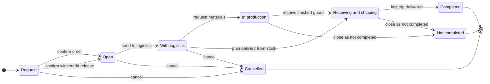
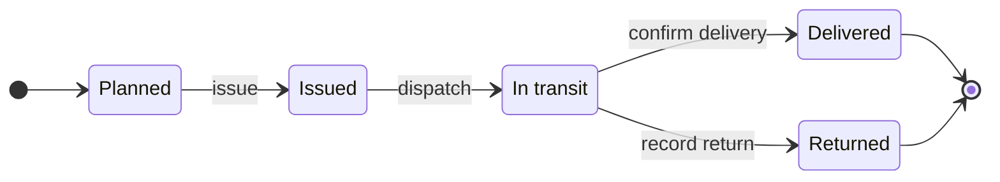
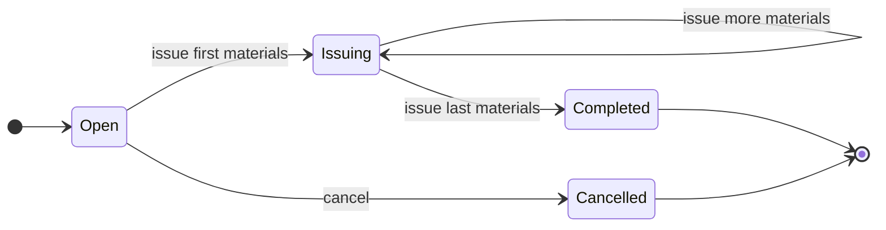
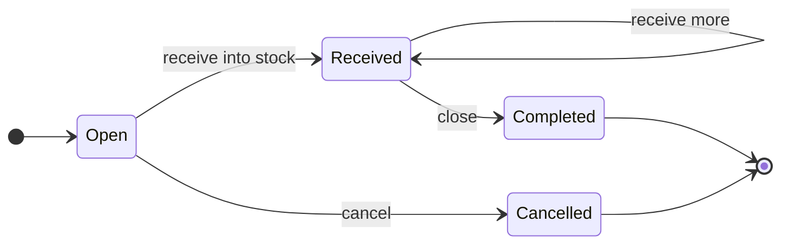
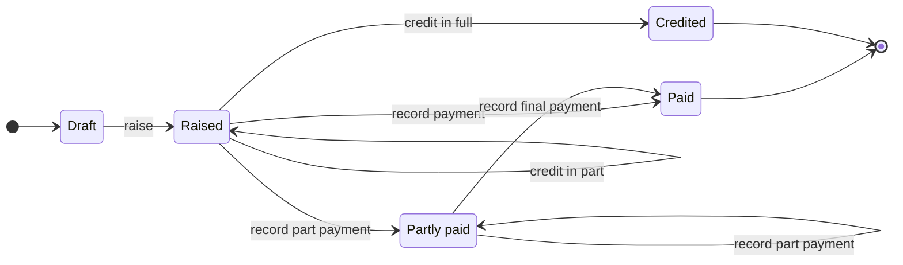
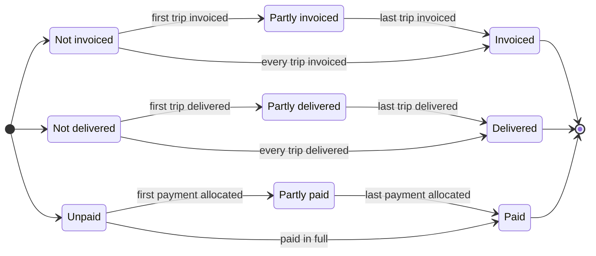
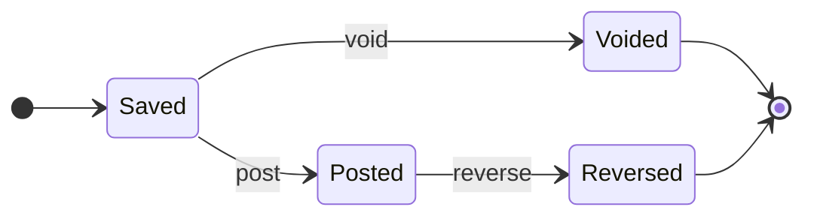

# State model: Tanmark Industries

**Tanmark Industries is fictional.** The patterns are real ones from order-processing and accounting systems. Generated by `state/model.py`; do not edit by hand.

Every document below has a lifecycle. Each move names its event, the role allowed to make it, the condition that must hold, and what the system does. Moves the system must refuse are listed too, because each one is an error path in the user stories.

## Rules that always hold

| ID | Rule |
|---|---|
| R1 | No document is ever deleted. Every closure is a state, so each record and its number survive. |
| R2 | A posted voucher or a raised invoice never changes. A correction is a reversing voucher or a credit note. |
| R3 | Nothing that has moved stock is cancelled. An order in production closes as Not completed; a material request that has issued completes; a received purchase order is returned to the supplier. |
| R4 | A delivered trip is read-only, and a closed order freezes itself and all its trips. |
| R5 | The warehouse issues exactly the planned quantity, or the plan is revised first. |
| R6 | After an order goes to logistics, sales cannot edit it. A quantity may fall in place; a rise is a new order. |
| R7 | Roles grant access to data; the transition table grants the right to move a document. The two are separate. |
| R8 | A stock form gets its official number only when the stock moves. Before that it is a draft with no number. |
| R9 | Goods leave only with their invoice: each trip has one invoice, raised before the trip is dispatched. |
| R10 | Sales are on credit terms set per customer and contract, 30 days unless the contract says otherwise. A customer over its credit limit, or with an invoice past due, gets no new order unless the chief accountant releases it. |

## Sales order

| From | Event | To | Who | Condition | System action |
|---|---|---|---|---|---|
| Request | confirm order | Open | Sales staff | customer, lines and prices complete; the contract is not on credit hold | order number assigned; fulfilment can start |
| Request | confirm with credit release | Open | Chief accountant | the contract is on credit hold; a reason is recorded | order number assigned; the release is logged |
| Request | cancel | Cancelled | Sales staff | none | kept as a cancelled request |
| Open | send to logistics | With logistics | Sales staff | a salesperson is assigned | sales editing locks; logistics sees the order |
| Open | cancel | Cancelled | Sales staff, Sales manager | none | flag only; nothing is deleted |
| With logistics | request materials | In production | Logistics coordinator | a production plan exists | material request raised for the workshop |
| With logistics | plan delivery from stock | Receiving and shipping | Logistics coordinator | finished goods already in stock | delivery trips planned |
| With logistics | cancel | Cancelled | Sales manager | none | flag only; nothing is deleted |
| In production | receive finished goods | Receiving and shipping | Warehouse keeper | none | stock increases; delivery trips can be planned |
| In production | close as not completed | Not completed | Sales manager | none | stock already received stays valid; open demand is dropped |
| Receiving and shipping | last trip delivered | Completed | System | every trip is Delivered or Returned | order and its trips freeze |
| Receiving and shipping | close as not completed | Not completed | Sales manager | none | stock already received stays valid; undelivered lines are dropped |

**Refused:**

* Request: **confirm on credit hold** is refused. The customer is over its credit limit or overdue. The chief accountant must release the order.
* With logistics: **sales edit** is refused. After handoff, sales cannot edit the order. Raise a new order for an increase.
* In production: **cancel** is refused. Production has started. Close the order as Not completed instead.
* Receiving and shipping: **cancel** is refused. Goods exist. Close the order as Not completed instead.
* Completed: **edit** is refused. A completed order is frozen.

After **send to logistics**, sales can no longer edit the order. A quantity may be reduced at any stage; an increase is raised as a new order.
The sales document also carries three statuses, rolled up from its trips and invoices (see **Sale statuses**).
A contract is on credit hold while its balance is above the credit limit or an invoice is past its due date (R10).

## Delivery trip

| From | Event | To | Who | Condition | System action |
|---|---|---|---|---|---|
| Planned | issue | Issued | Warehouse keeper | issued quantity equals planned quantity | stock decreases; issue form numbered |
| Issued | dispatch | In transit | Logistics coordinator | departure time set; the trip's invoice is Raised | the trip leaves with its invoice |
| In transit | confirm delivery | Delivered | Logistics coordinator | arrival time set | trip becomes read-only |
| In transit | record return | Returned | Warehouse keeper | none | returned goods received back into stock; the trip's invoice is credited |

**Refused:**

* Delivered: **edit times or quantities** is refused. A delivered trip is read-only.
* Planned: **issue a different quantity** is refused. Issue exactly the plan, or revise the plan first.
* Planned: **edit when the order is closed** is refused. A completed, cancelled or not-completed order freezes its trips.
* Planned: **download numbered form** is refused. No stock has moved yet. Preview the draft form; its number is given when the goods are issued.
* Issued: **dispatch without an invoice** is refused. Goods leave only with their invoice. Raise the trip's invoice first.

Each line on a trip has its own status (issued, received, returned) that rolls up to the trip.
Each trip has exactly one invoice, raised after the goods are issued and before the trip leaves (R9).
Before the stock moves, the warehouse keeper can preview and download the form as a draft with no number; the official number is given with the movement (D15, R8).

## Material request

| From | Event | To | Who | Condition | System action |
|---|---|---|---|---|---|
| Open | issue first materials | Issuing | Warehouse keeper | the factory manager is assigned | stock decreases; issue form numbered |
| Open | cancel | Cancelled | Factory manager | nothing issued | flag only |
| Issuing | issue more materials | Issuing | Warehouse keeper | lines still open | stock decreases; a new issue form numbered |
| Issuing | issue last materials | Completed | Warehouse keeper | every line issued in full | issue form numbered |

**Refused:**

* Issuing: **cancel** is refused. Materials have left the warehouse. Complete the request, or close the order as Not completed.
* Open: **download numbered form** is refused. No stock has moved yet. Preview the draft form; its number is given when the materials are issued.

Before the stock moves, the warehouse keeper can preview and download the form as a draft with no number; the official number is given with the movement (D15, R8).

## Purchase order

| From | Event | To | Who | Condition | System action |
|---|---|---|---|---|---|
| Open | receive into stock | Received | Warehouse keeper | goods counted against the order | stock increases; receipt form numbered; the order counts as approved (D9) |
| Received | receive more | Received | Warehouse keeper | goods counted against the open lines | stock increases; a new receipt form numbered |
| Open | cancel | Cancelled | Purchasing staff | nothing received | flag only |
| Received | close | Completed | Purchasing staff | every line received; the supplier invoice is recorded | none |

**Refused:**

* Received: **cancel** is refused. Goods are in stock. Return them to the supplier instead.
* Open: **download numbered form** is refused. No stock has moved yet. Preview the draft form; its number is given when the goods are received.

There is no Approved state. The signature stays on paper, outside the system (decision D9).
Before the stock moves, the warehouse keeper can preview and download the form as a draft with no number; the official number is given with the movement (D15, R8).

## Sales invoice and receivable (one per trip)

| From | Event | To | Who | Condition | System action |
|---|---|---|---|---|---|
| Draft | raise | Raised | Accountant | the trip is Issued; one invoice per trip | invoice number assigned; due date set from the contract's payment terms |
| Raised | record payment | Paid | Accountant | the trip is Delivered; a receipt allocated, equal to the balance | balance cleared |
| Raised | record part payment | Partly paid | Accountant | the trip is Delivered; a receipt allocated, less than the balance | balance due updated |
| Raised | credit in part | Raised | Chief accountant | a credit note for less than the balance: a price correction or a short return | credit note issued; balance reduced |
| Partly paid | credit in part | Partly paid | Chief accountant | a credit note for less than the balance still due | credit note issued; balance reduced |
| Partly paid | record part payment | Partly paid | Accountant | a balance is still due | balance due updated |
| Partly paid | record final payment | Paid | Accountant | receipts equal the amount due | balance cleared |
| Raised | credit in full | Credited | Chief accountant | the trip is Returned | credit note issued; balance cleared |

**Refused:**

* Draft: **raise before the trip is issued** is refused. Raise the invoice for goods the warehouse has issued to the trip.
* Raised: **edit amount** is refused. Correct an invoice with a credit note, never by editing it.

The due date is the invoice date plus the payment terms of the customer's contract: 30 days unless the contract sets other terms (R10).
Overdue is not a state. It is the invoice's age past its due date, shown in the ageing view: current, 1 to 30, 31 to 60, 61 to 90 and over 90 days.
A customer's transfer usually pays several invoices. The receipt voucher is allocated to them, oldest due date first, and only to invoices whose trip is Delivered; anything else is held unallocated and flagged to finance.
Each quarter, the open receivables are reconciled with every customer on a statement the customer signs.

## Sale statuses: invoiced, delivered, paid

| From | Event | To | Who | Condition | System action |
|---|---|---|---|---|---|
| Not invoiced | first trip invoiced | Partly invoiced | System | trips still to invoice | none |
| Partly invoiced | last trip invoiced | Invoiced | System | every trip has its invoice | none |
| Not invoiced | every trip invoiced | Invoiced | System | a single trip, or all at once | none |
| Not delivered | first trip delivered | Partly delivered | System | trips still in transit | none |
| Partly delivered | last trip delivered | Delivered | System | every trip is Delivered or Returned | none |
| Not delivered | every trip delivered | Delivered | System | a single trip, or all at once | none |
| Unpaid | first payment allocated | Partly paid | System | a balance is still due | none |
| Partly paid | last payment allocated | Paid | System | every invoice is Paid or Credited | none |
| Unpaid | paid in full | Paid | System | every invoice is Paid or Credited | none |

**Refused:**

* Not invoiced: **deliver before invoicing** is refused. A trip leaves only with its invoice. Raise the trip's invoice first.

Each status rolls up from the trips and their invoices; nobody sets it by hand.
A returned trip counts as closed for both roll-ups: its goods are back in stock, and its invoice is credited. So a return does not leave the sale, or the order, waiting for ever.
The three move in order. A trip leaves only with its invoice (R9), and customers pay on credit terms after delivery (R10), so a sale is never more delivered than invoiced, or paid before it is delivered. The legal combinations are in working paper W6.

## Accounting voucher (receipt or payment)

| From | Event | To | Who | Condition | System action |
|---|---|---|---|---|---|
| Saved | post | Posted | Accountant | the entries balance | voucher locks; ledger updated |
| Saved | void | Voided | Accountant | none | amount set to zero; number kept in the sequence |
| Posted | reverse | Reversed | Chief accountant | a reason is recorded | an offsetting voucher is posted; the original stays |

**Refused:**

* Posted: **edit** is refused. A posted voucher is locked. Reverse it instead.
* Saved: **delete** is refused. Nothing is ever deleted. Void it instead.

Saving and posting are separate acts. Only posting reaches the ledger.

## Decided versus built

Rules decided in the meetings, checked against the build during UAT. **Fictional entries; the kind of gap is real.** A BA finds these by testing each rule, not by reading the code.

| ID | Decided | Found in the build | Outcome |
|---|---|---|---|
| DB-1 | R2 posted vouchers are locked | vouchers had no posted status; saved and posted looked the same | found in UAT; ticketed; a go / no-go criterion for finance |
| DB-2 | R6 sales cannot edit after handoff | sales could still edit an order with logistics | found in UAT; fixed before the parallel run |
| DB-3 | R7 account changes need a role | chart-of-accounts permission checks were switched off during the build | found in UAT; switched on before the parallel run |
| DB-4 | R3 nothing that has moved stock is cancelled | built as decided | no gap |
