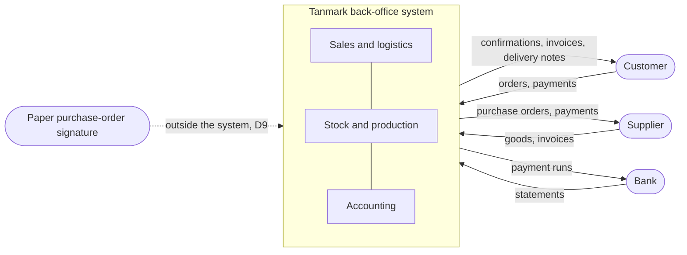

# W1. Project charter and scope

**Tanmark Industries is fictional.**

## Purpose

Move Tanmark's order to cash, procure to pay and accounting from paper, email and spreadsheets onto one system, so that
every order, purchase and voucher has a visible state and a traceable history.

## Business objectives

| ID | Objective | Measured by |
|---|---|---|
| O1 | Anyone who needs it can see where an order is | every order carries a named state; status questions by email fall (illustrative) |
| O2 | Stock in the system matches the shelves | weekly cycle-count differences; no stock left issued to a cancelled order |
| O3 | Orders are delivered faster, and collected on their terms | median days from order to delivery; share of receivables overdue (synthetic dataset, illustrative) |
| O4 | The ledger can be audited | no deleted vouchers; posted vouchers never change; the voucher sequence has no gaps |
| O5 | Purchasing is not slowed by a second approval | purchase orders open on creation; approval stays on paper (D9) |

## Scope

| In scope | Out of scope |
|---|---|
| sales orders, from request to completion or closure | customer relationship management beyond the customer record |
| material requests and issues to the workshop | production scheduling and machine capacity |
| purchase orders and receipts | supplier sourcing and tendering |
| delivery trips | vehicle routing |
| sales invoices (one per trip), receipt and payment vouchers | payroll, fixed assets, tax filing |
| customer contracts: payment terms, credit limits, credit hold; receivables ageing and allocation | debt collection agencies and legal recovery |
| roles, the transition table, the decided-versus-built register | a supplier portal or a customer portal |

## Context diagram

What the system exchanges with the world outside it. Everything inside the box is in scope.

## Constraints and assumptions

* A team of six developers and one product owner; releases every two weeks.
* A two-month pilot group first (D2); then paper runs in parallel for one month in every department (D12).
* Staff are new to shared systems; training is by role and by shift.
* Assumptions are tracked in the RAID log (W10).

## Sign-off

| Role | Signs for |
|---|---|
| Executive sponsor | the charter, the objectives and the go / no-go of each phase |
| Product owner | the scope, the requirements and the rollout |
| Department heads | the stories and UAT for the processes they own |
