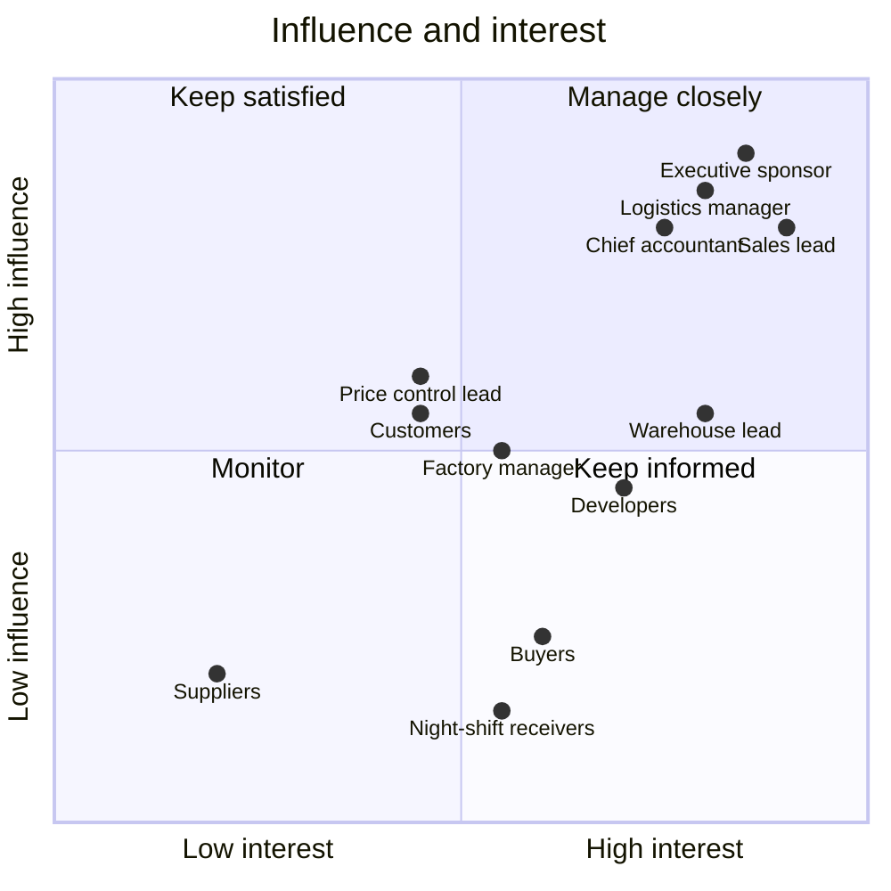

# W2. Stakeholder register and map

**Tanmark Industries is fictional; stakeholders are roles, not people.**

**The finding first.** The night-shift receivers sat in "keep informed" at the start: low influence on the design. The
pilot stall showed they had high influence on adoption, and training by shift was the fix (W12, L2). A stakeholder map
is a hypothesis about influence, and the pilot is where it gets tested.

## Register

| Stakeholder | Interest | Influence | What they need from the system | Engagement |
|---|---|---|---|---|
| Executive sponsor | high | high | a visible pipeline; a controlled rollout | weekly roadmap review; go / no-go per phase |
| Sales lead | high | high | orders that move without phone calls | discovery, story review, UAT sign-off |
| Logistics manager | high | high | plans that do not change under them; paper signature kept (D9) | discovery, closure rules (D6), UAT sign-off |
| Chief accountant | high | high | posted vouchers that never change; no deletes (D10) | posting policy, UAT sign-off |
| Warehouse lead | high | medium | stock that matches the shelves | discovery, cycle counts, UAT |
| Factory manager | medium | medium | material requests that arrive complete | discovery, material-request rules |
| Price control lead | medium | medium | purchase prices checked before a purchase order goes out | discovery, purchasing rules |
| Buyers | medium | low | no second approval step (D9) | discovery, pilot group |
| Night-shift receivers | medium | low | training on their shift | shift training, pilot feedback |
| Tech lead and developers | high | medium | stable requirements and a transition table | backlog refinement, sprint reviews |
| Customers | medium | medium | accurate delivery dates and invoices; warning before a new order is held for credit (D17) | through their sales contact: told four weeks before the parallel run; a call to each customer on the hold list (W12, RK-6) |
| Suppliers | low | low | purchase orders and payments on time | none directly; through buyers |

## Map

