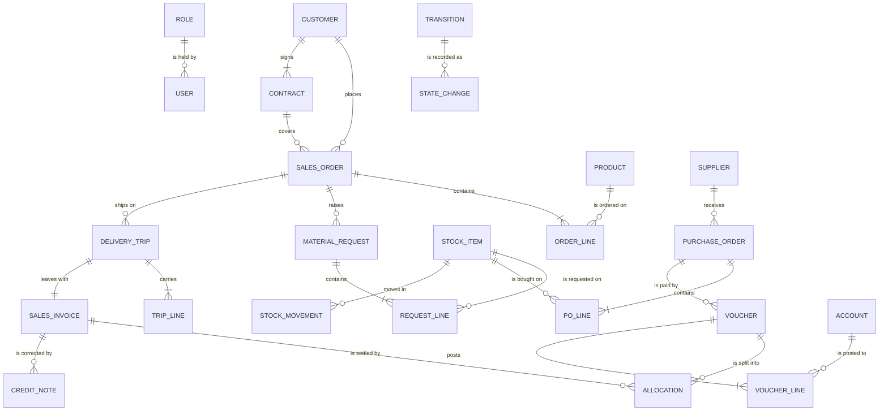

# W4. Data model and data dictionary

**Tanmark Industries is fictional.** A logical model: it names what the business records and how records relate, not tables.

## Entities and relationships

## Data dictionary (the fields that carry the rules)

| Entity | Field | Type | Rule |
|---|---|---|---|
| SALES_ORDER | number | text, unique | assigned on **confirm order**, never reused |
| SALES_ORDER | state | one of the sales-order states | changes only through a transition (W6, R7) |
| SALES_ORDER | locked_for_sales | yes / no | yes from **send to logistics** (R6) |
| SALES_ORDER | invoice_status, payment_status, delivery_status | three separate fields | each moves on its own (D8) |
| SALES_ORDER | released_by, release_reason | a person, text | set only when the chief accountant confirms an order on credit hold (R10) |
| CONTRACT | payment_terms_days | whole number, default 30 | sets every invoice's due date (R10) |
| CONTRACT | credit_limit | money | above it, the contract is on credit hold (R10) |
| CONTRACT | on_credit_hold | computed yes / no | balance above the limit, or an invoice past its due date |
| SALES_INVOICE | trip | one delivery trip, unique | one invoice per trip; the trip cannot leave without it (R9) |
| SALES_INVOICE | due_date | date | invoice date plus the contract's payment terms |
| SALES_INVOICE | balance_due | money | falls with each allocation; the invoice is Paid at zero |
| ALLOCATION | receipt voucher, invoice, amount | links and money | oldest due date first; only to invoices whose trip is Delivered; never more than the receipt, or than the invoice's balance; the rest is held unallocated and flagged to finance |
| ORDER_LINE | quantity | whole number | may fall in place; a rise is a new order (R6) |
| SALES_ORDER | state (closure) | as above | In production or later: cancel refused, close as Not completed (R3) |
| MATERIAL_REQUEST | issued_quantity | whole number | above zero blocks cancelling the request (R3) |
| PURCHASE_ORDER | state | Open, Received, Completed, Cancelled | no Approved state (D9) |
| DELIVERY_TRIP | planned_quantity, issued_quantity | whole numbers | equal, or the issue is refused (R5) |
| STOCK_MOVEMENT | form_number | text, unique | assigned when the stock moves, one per receipt or issue; a draft preview has none (R8, D15) |
| DELIVERY_TRIP | delivered_at | date and time | once set, the trip is read-only (R4) |
| VOUCHER | number | sequence, no gaps | kept even when voided (R1) |
| VOUCHER | state | Saved, Posted, Voided, Reversed | Posted is locked (R2) |
| VOUCHER | reverses | the voucher it corrects | set only on a reversing voucher |
| CREDIT_NOTE | invoice, amount, reason | a link, money, text | the only way to correct a raised invoice (R2, B5) |
| STATE_CHANGE | document, from, to, by, at, reason | one row per move | written by every transition; never edited |
| any document | deleted | **no such field** | nothing is deleted (R1) |

## Design notes

* **State is a field, and moving it is an event.** The STATE_CHANGE record is the audit trail; it is how a closed order
  explains itself.
* **Three status fields, not one combined field,** on the sales order (D8). A combined field would need a value for every
  combination, twenty-seven once each can be partial, and would hide which step is missing.
* **No delete flag.** A delete flag would reintroduce the thing D10 removed.
